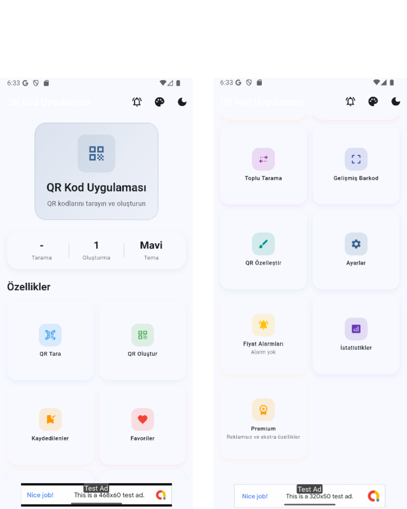
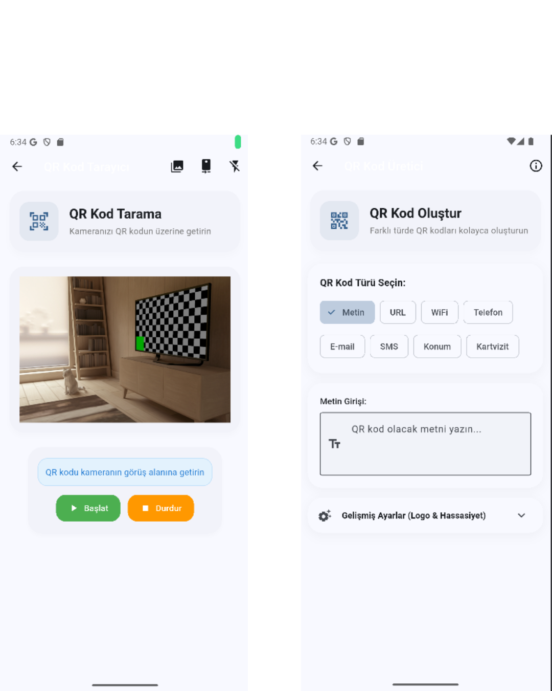
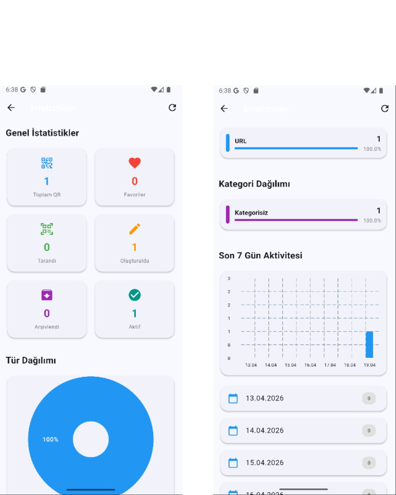
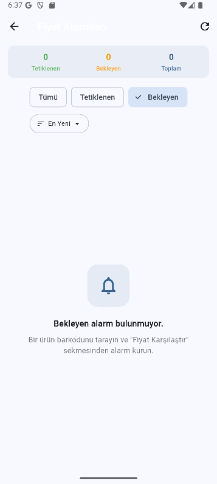

<div align="center">
  

  # ScanMaster QR 🚀

  **Hepsi Bir Arada, Hızlı ve Profesyonel QR Kod Çözümü**

  [](https://flutter.dev)
  [](https://firebase.google.com)
  [](https://pub.dev/packages/provider)
  [](LICENSE)
</div>

<br>

**ScanMaster QR**, modern tasarımı ve gelişmiş özellikleriyle hem günlük kullanıcılar hem de profesyoneller için geliştirilmiş kapsamlı bir QR kod okuyucu ve oluşturucu mobil uygulamasıdır. Flutter ile geliştirilmiş olup iOS ve Android platformlarında yüksek performansla çalışır.

---

## 📸 Ekran Görüntüleri

<div align="center">
  
  
  
  
</div>

---

## ✨ Öne Çıkan Özellikler

*   **📱 Hızlı ve Güvenilir Tarama:** Kamera üzerinden anında QR kodları tarama ve otomatik odaklama.
*   **🎨 Zengin QR Kod Oluşturma:** URL, Metin, E-posta, Telefon, SMS, WiFi, Konum ve Kartvizit tiplerinde özelleştirilebilir QR kodları.
*   **🌙 Dinamik Tema Desteği:** Sistem ayarlarıyla uyumlu Karanlık (Dark) ve Aydınlık (Light) tema seçeneği.
*   **☁️ Bulut Senkronizasyonu & Firebase:** Kullanıcı oturumu (Google Sign-In), verilerin güvenli yedeklenmesi ve senkronizasyonu.
*   **📊 İstatistik ve Analizler:** Okunan ve oluşturulan kodların geçmişi, uygulama kullanım istatistikleri.
*   **💎 Premium Özellikler:** Uygulama içi satın alma (In-App Purchases) entegrasyonu ile reklamsız deneyim ve ekstra özelliklerin kilidini açma.
*   **🔔 Akıllı Bildirimler:** Çevrimdışı çalışan lokal bildirimler ve hatırlatıcılar.
*   **📉 Analitik ve Crashlytics:** Firebase Analytics ve Crashlytics ile gelişmiş hata takibi ve performans ölçümü.

## 🛠️ Kullanılan Teknolojiler & Mimari

*   **Framework:** [Flutter](https://flutter.dev/)
*   **State Management:** `Provider` mimarisi
*   **Backend & Veritabanı:** Firebase (Auth, Analytics, Crashlytics, Performance)
*   **Tarama Motoru:** `mobile_scanner` & `qr_flutter`
*   **Para Kazanma & Reklam:** `in_app_purchase` (Premium abonelikler) & `google_mobile_ads`
*   **Animasyonlar:** Lottie entegrasyonu
*   **Yerel Bildirimler:** `flutter_local_notifications`

## 🚀 Başlarken

Projeyi kendi bilgisayarınızda çalıştırmak için aşağıdaki adımları izleyin:

### Ön Gereksinimler
*   [Flutter SDK](https://docs.flutter.dev/get-started/install) (sürüm ^3.9.2 veya üstü)
*   [Android Studio](https://developer.android.com/studio) / [VS Code](https://code.visualstudio.com/)
*   Firebase projesi oluşturulmuş ve `google-services.json` (Android) / `GoogleService-Info.plist` (iOS) dosyaları projeye eklenmiş olmalıdır.

### Kurulum

1. Repoyu klonlayın:
```bash
git clone https://github.com/berat1834/qr_app.git
```

2. Proje dizinine gidin:
```bash
cd qr_app
```

3. Bağımlılıkları yükleyin:
```bash
flutter pub get
```

4. Uygulamayı çalıştırın:
```bash
flutter run
```

## 🤝 Katkıda Bulunma

Bu proje açık kaynaklıdır ve katkılarınızı bekliyoruz. Bir sorun (issue) açabilir veya bir pull request (PR) gönderebilirsiniz.

## 📝 Lisans

Bu proje [MIT Lisansı](LICENSE) altında lisanslanmıştır. Daha fazla bilgi için `LICENSE` dosyasına bakabilirsiniz.

---
*Geliştirici:* [Berat](https://github.com/berat1834) | *LinkedIn:* [Profilinizi Buraya Ekleyin](https://linkedin.com/in/)
